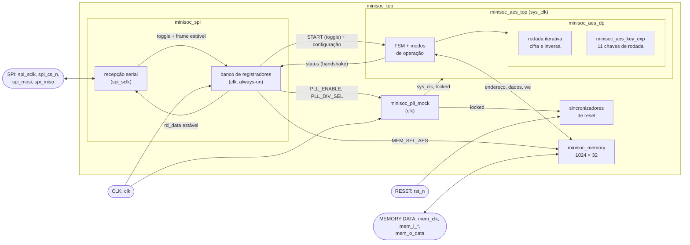
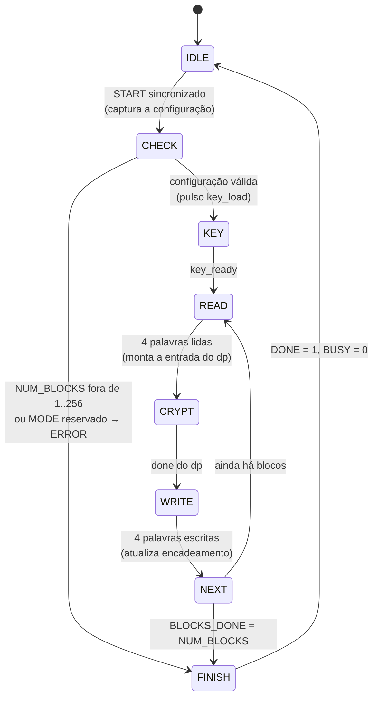

# Microarquitetura v1.0 — MiniSoC AES (trilha RTL)

**Especificação:** Block Guide MiniSoC AES v1.0.0 · **Semana:** 3 · **Estado:** v1.0, para a defesa curta e para o verificador parceiro

O Block Guide fixa o que o sistema faz: interfaces de topo (seção 3), módulos e arquivos (1.3 e 10), mapa de registradores (6), protocolo SPI (5) e modelo de programação (9). Este documento define **como** o RTL implementa isso: diagrama interno, microarquitetura do AES, FSM do `minisoc_aes_top`, travessias de domínio de clock e sequência de reset. As decisões que dependem de pontos ainda abertos no Block Guide estão marcadas como **premissa** e remetem à lista de dúvidas do [relatório da semana 2](../reports/semana_02.md#dúvidas-sobre-o-block-guide-seções-1-a-3-e-8).

---

## 1. Diagrama de blocos interno



| Bloco | Arquivo (seção 10) | Domínio de clock | Semana |
| --- | --- | --- | --- |
| Topo, sincronizadores de reset e mux de clock da memória | `rtl/minisoc_top.sv` | todos | 7 |
| PLL mock | `rtl/minisoc_pll/minisoc_pll_mock.sv` | `clk` → gera `sys_clk` | 5 |
| SPI front-end e banco de registradores | `rtl/minisoc_spi/minisoc_spi.sv` | `spi_sclk` e `clk` | 5 |
| AES engine (FSM, modos, acesso à memória) | `rtl/minisoc_aes/minisoc_aes_top.sv` | `sys_clk` | 6 |
| Datapath AES-128 (cifra e inversa de 1 bloco) | `rtl/minisoc_aes/minisoc_aes_dp.sv` | `sys_clk` | 4 |
| Expansão de chave | `rtl/minisoc_aes/minisoc_aes_key_exp.sv` | `sys_clk` | 4 |
| Transformações de rodada (SubBytes … InvMixColumns) | `rtl/minisoc_aes/minisoc_aes_*.sv` | combinacionais | 2 e 3 |
| Memória compartilhada | `rtl/minisoc_mem/minisoc_memory.sv` | `mem_clk` ou `sys_clk` | 6 |

Os submódulos de `minisoc_aes/` (S-box, SubBytes, ShiftRows, MixColumns, AddRoundKey e inversas) e as células genéricas de sincronização são arquivos extras, um módulo por arquivo, listados em `rtl/rtl.f`. Se o ambiente da trilha DV exigir só os arquivos da seção 10, eles podem ser concatenados sem mudança de comportamento (dúvida 6).

---

## 2. Domínios de clock

| Clock | Origem | Frequência (Block Guide) | O que roda nele |
| --- | --- | --- | --- |
| `clk` | pino CLK | 2 GHz | PLL mock, banco de registradores, lado `clk` dos sincronizadores |
| `sys_clk` | PLL mock: `clk` /1, /2, /4 ou /8, liberado só após o lock | 2 GHz a 250 MHz | AES engine (`minisoc_aes_top`, `_dp`, `_key_exp`) |
| `spi_sclk` | pino SPI | ≤ 25 MHz | registrador de deslocamento, contador de bits e MISO |
| `mem_clk` | pino MEMORY DATA | ≤ 200 MHz | memória, quando MEM_SEL_AES = 0 |

**Premissa (dúvida 1):** `clk` e `sys_clk` são tratados como **assíncronos**. O `sys_clk` vem da divisão do `clk`, mas a fase depois do lock e do bloqueio do clock não é garantida pelo modelo; tratar como assíncrono é correto nos dois casos (se forem síncronos, os sincronizadores só acrescentam alguns ciclos de latência).

---

## 3. Travessias de domínio (CDC)

| Travessia | Sinais | Técnica | Por que é segura |
| --- | --- | --- | --- |
| `spi_sclk` → `clk` | frame completo (40 bits) | **toggle** de frame + dados estáveis (seção 5.3) | o frame fica parado num registrador até o próximo frame; só o bit de toggle cruza, por 2 flip-flops |
| `clk` → `spi_sclk` | valor lido (32 bits) para a 2ª transação da leitura | dado estável (`rd_data`) lido pelo contador de bits | `rd_data` é escrito ao processar o READ request e só muda no próximo; a 2ª transação começa muito depois |
| `clk` → `sys_clk` | START | pulso → toggle → 2 FFs → detector de borda | só 1 bit cruza |
| `clk` → `sys_clk` | KEY, IV, COUNTER, MODE, DECRYPT, NUM_BLOCKS | dados estáveis capturados no START sincronizado | o software os programa antes do START (seção 9, passos 3 a 7) e não os muda com BUSY = 1 |
| `sys_clk` → `clk` | BUSY, DONE, ERROR, BLOCKS_DONE (12 bits) | **handshake** req/ack com instantâneo do status | o lado `clk` só copia o instantâneo quando ele está parado; nunca há mistura de bits de momentos diferentes |
| `clk` → `sys_clk` | MEM_SEL_AES (para validar o START) | 2 FFs | nível de 1 bit |
| `mem_clk` / `sys_clk` | clock, endereço, dados e we da memória | mux selecionado por MEM_SEL_AES | a seção 7.2 só permite a troca com o AES ocioso e sem acesso externo: com `we` em 0 dos dois lados, um eventual *glitch* no clock não escreve nada (dúvida 4) |

### 3.1 `spi_sclk` → `clk`: sincronização por toggle

```
domínio spi_sclk                         domínio clk
-----------------                        -----------------------------------------
shift[39:0] <- MOSI (borda de subida)
no 40º bit:  frame_q <- shift            frame_q é lido só depois do pulso abaixo
             tgl_q   <- ~tgl_q  ------>  s1 <- tgl_q; s2 <- s1; s3 <- s2   (2 FFs + borda)
                                         pulso = s2 ^ s3  -> decodifica frame_q
```

O `spi_sclk` só oscila durante o frame: um pulso de um ciclo de `spi_sclk` poderia nunca ser visto pelo `clk`. O toggle é um **nível** que muda uma vez por frame e fica parado até o próximo, então o sincronizador sempre o captura. O `frame_q` (RWb, ADDR, DATA) é estável desde a última borda do frame até o fim do próximo frame, com folga enorme: um frame de 40 bits a 25 MHz dura 1,6 µs, e o pulso chega ao `clk` em cerca de 3 ciclos (1,5 ns a 2 GHz).

**Leitura em duas transações (seção 5.1).** O primeiro frame é um READ request com o endereço. Ao decodificá-lo, o banco copia o registrador endereçado para `rd_data` (domínio `clk`). No segundo frame (endereço NOP 0x3F), o MISO sai de um mux indexado pelo contador de bits do domínio `spi_sclk`, lendo `rd_data`, que está estável desde o fim do primeiro frame. **Premissa (dúvida 14):** o valor lido ocupa o campo DATA (bits 31:0 do frame).

### 3.2 START, configuração e status entre `clk` e `sys_clk`

- **START** é write-one-pulse (seção 6.1). A escrita gera um toggle no domínio `clk`, sincronizado por 2 FFs no `sys_clk`. **Decisão:** START escrito com PLL_LOCKED = 0 é descartado, porque sem `sys_clk` não há quem o receba (o modelo de programação só manda START depois do lock, passos 9 a 11).
- **Configuração:** o `minisoc_aes_top` copia KEY, IV, COUNTER, MODE, DECRYPT e NUM_BLOCKS no ciclo do START sincronizado (seção 8.3). As cópias, e não os registradores do banco, são usadas durante toda a operação.
- **Status:** a cada mudança, o lado `sys_clk` congela BUSY, DONE, ERROR e BLOCKS_DONE num registrador e faz um pedido (toggle); o lado `clk` sincroniza o pedido, copia o instantâneo para AES_STATUS e devolve o reconhecimento. BLOCKS_DONE tem 9 bits e pode ir de 255 a 0 num START, por isso não cruza bit a bit.

---

## 4. Sequência de reset (seção 4.2)

| Domínio | Reset | Comportamento |
| --- | --- | --- |
| `clk` | `rst_n` por sincronizador de 2 FFs | assert assíncrono, deassert síncrono ao `clk` |
| `sys_clk` | `rst_n` **ou** PLL sem lock, por sincronizador de 4 estágios | fica em reset enquanto não houver lock; sai do reset 4 bordas de `sys_clk` depois de o clock ser liberado (premissa para os "ciclos suficientes", dúvida 3) |
| `spi_sclk` | `rst_n` ou `spi_cs_n` = 1 | contador de bits e registrador de deslocamento zeram fora do frame: cada frame começa limpo |
| memória | nenhum | a memória não tem reset funcional (seções 3 e 7.3) |

```
rst_n       ‾‾\____/‾‾‾‾‾‾‾‾‾‾‾‾‾‾‾‾‾‾‾‾‾‾‾‾‾‾‾‾‾‾‾‾‾‾‾‾‾‾‾‾‾‾‾‾‾‾‾‾‾‾‾‾‾
rst_clk_n   ‾‾\______/‾‾‾‾‾‾‾‾‾‾‾‾‾‾‾‾‾‾‾‾‾‾‾‾‾‾‾‾‾‾‾‾‾‾‾‾‾‾‾‾‾‾‾‾‾‾‾‾‾‾‾   (2 ciclos de clk)
PLL_ENABLE  _______________/‾‾‾‾‾‾‾‾‾‾‾‾‾‾‾‾‾‾‾‾‾‾‾‾‾‾‾‾‾‾‾‾‾‾‾‾‾‾‾‾‾‾‾‾‾‾   (escrita via SPI)
locked      ______________________________/‾‾‾‾‾‾‾‾‾‾‾‾‾‾‾‾‾‾‾‾‾‾‾‾‾‾‾‾‾‾‾   (atraso pseudoaleatório)
sys_clk     ______________________________/‾\_/‾\_/‾\_/‾\_/‾\_/‾\_/‾\_/‾\_   (liberado após o lock)
rst_sys_n   ____________________________________________________/‾‾‾‾‾‾‾‾   (4 bordas de sys_clk)
```

Como o banco de registradores está no domínio always-on `clk` (seção 2.2), desabilitar ou reconfigurar o PLL só reinicia o domínio do AES: a configuração programada por SPI é preservada.

---

## 5. Microarquitetura do AES

### 5.1 Escolha: iterativa, uma rodada por ciclo

O `minisoc_aes_dp` tem um registrador de estado de 128 bits e o hardware de **uma** rodada, reaproveitado dez vezes. A cada ciclo, o estado passa por uma rodada completa, com a chave daquela rodada.

```
            block_i ──► ⊕ rk(0 ou 10) ──┐  (ciclo do start)
                                        ▼
                                   ┌─────────┐
                ┌─────────────────►│ state_q │──────────────► block_o
                │                  └────┬────┘
                │        ┌──────────────┴───────────────┐
                │        ▼ cifra                        ▼ cifra inversa
                │   SubBytes (16 S-box)          InvShiftRows (fios)
                │   ShiftRows (fios)             InvSubBytes (16 S-box inv.)
                │   MixColumns ──┐               AddRoundKey ◄── rk[10-r]
                │     última: pula│              InvMixColumns ──┐
                │   AddRoundKey ◄─┴── rk[r]        última: pula  │
                │        │                              │
                └────────┴──────── mux (sentido) ◄──────┘
```

| Borda de clock | Cifra (FIPS-197 5.1) | Cifra inversa (FIPS-197 5.3) |
| --- | --- | --- |
| 0 (start aceito) | `state ← bloco ⊕ rk0` | `state ← bloco ⊕ rk10` |
| r = 1 a 9 | `state ← MixColumns(ShiftRows(SubBytes(state))) ⊕ rk[r]` | `state ← InvMixColumns(InvSubBytes(InvShiftRows(state)) ⊕ rk[10−r])` |
| 10 | `state ← ShiftRows(SubBytes(state)) ⊕ rk10`; `done_o` | `state ← InvSubBytes(InvShiftRows(state)) ⊕ rk0`; `done_o` |

**Latência:** 11 ciclos por bloco, nos dois sentidos. **Vazão do datapath:** 128 bits a cada 11 ciclos; a 500 MHz, cerca de 5,8 Gbit/s, sem contar o acesso à memória.

### 5.2 Alternativas consideradas

| Microarquitetura | Ciclos por bloco | Área relativa | Por que não agora |
| --- | --- | --- | --- |
| **Iterativa, 128 bits, 1 rodada por ciclo (escolhida)** | 11 | 1× | — |
| Iterativa com a rodada em 2 estágios | 21 | +128 FFs | só se a frequência-alvo exigir (seção 5.5) |
| Desenrolada com pipeline (10 rodadas) | 1 por ciclo de vazão | ~10× | CBC, PCBC, CFB e OFB realimentam o bloco anterior: o pipeline ficaria vazio na maior parte do tempo |
| Coluna por ciclo (32 bits, 4 S-boxes) | ~44 | ~0,3× do datapath | controle mais complexo e latência 4×; alternativa de área |
| S-box única para cifra e inversa | 11 | −16 tabelas | mais lógica no caminho crítico e verificação mais difícil |

### 5.3 Expansão de chave: pré-computada

O `minisoc_aes_key_exp` calcula as 11 chaves de rodada uma vez, ao receber a chave, e as guarda numa tabela de registradores. O datapath lê a chave da rodada por índice.

| Critério | Pré-computada (escolhida) | Sob demanda (*on-the-fly*) |
| --- | --- | --- |
| Quando calcula | uma vez por operação (11 ciclos), para até 256 blocos | a cada bloco, junto com as rodadas |
| Cifra inversa | lê rk10 … rk0: só muda o índice | precisa calcular rk10 antes e inverter a recorrência a cada rodada |
| Armazenamento | 11 × 128 = 1408 FFs + mux de leitura 11:1 de 128 bits | ~384 FFs (chave, rk10 e chave corrente) |
| Atividade de chaveamento | a tabela fica parada durante a operação | a lógica da expansão chaveia em todo bloco |
| Verificação | cada uma das 11 chaves é observável e conferida com o FIPS-197 A.1 | só a chave corrente é observável |

O Block Guide faz o engine capturar a chave uma vez e processar até 256 blocos (seção 8.3); com isso, a expansão roda 1 vez em vez de 256, e a cifra inversa fica trivial. O custo é área: reavaliar na semana 8 com o relatório de síntese; a alternativa sob demanda fica documentada aqui.

### 5.4 Custo estimado

| Recurso | Quantidade |
| --- | --- |
| Tabelas de S-box | 36 (16 no SubBytes, 16 no InvSubBytes, 4 no SubWord) |
| Flip-flops de dados | 128 (estado) + 1408 (chaves de rodada) + 128 (última chave) |
| Flip-flops de controle | ~13 (contadores e flags) |
| Redes de XOR | MixColumns, InvMixColumns e 3 AddRoundKey (inicial, cifra e inversa) |

### 5.5 Caminho crítico e frequência

O caminho mais longo é a rodada da **cifra inversa**: `state_q → InvShiftRows (fios) → S-box inversa → XOR da chave → InvMixColumns (~5 níveis de XOR) → muxes → state_q`. A rodada da cifra é um pouco mais curta, porque o MixColumns tem coeficientes menores. Em processos de 28 a 32 nm, a estimativa é algo entre 0,8 e 1 ns, ou seja, cerca de 1 GHz.

O Block Guide fala em `clk` de 2 GHz e `sys_clk` de até 2 GHz (divisor /1). **Premissa (dúvida 2):** a frequência-alvo da síntese é definida pelo instrutor; uma rodada por ciclo deve fechar em 500 MHz (/4) com folga. Se o alvo for 1 a 2 GHz, a rodada é dividida em dois estágios (registrador depois do SubBytes), sem mudar a interface `start`/`done`: só a latência passa de 11 para 21 ciclos.

---

## 6. Interfaces internas

### 6.1 `minisoc_aes_key_exp`

| Porta | Dir. | Largura | Função |
| --- | --- | --- | --- |
| `clk`, `rst_n` | I | 1 | clock e reset assíncrono ativo em baixo |
| `load_i` | I | 1 | pulso: começa a expandir `key_i` |
| `key_i` | I | 128 | chave (KEY0 em `[127:96]`, como na seção 6) |
| `ready_o` | O | 1 | as 11 chaves estão válidas (11 ciclos depois do `load_i`) |
| `round_i` | I | 4 | índice da chave lida, 0 a 10 |
| `round_key_o` | O | 128 | `rk[round_i]`, leitura combinacional |

### 6.2 `minisoc_aes_dp`

| Porta | Dir. | Largura | Função |
| --- | --- | --- | --- |
| `clk`, `rst_n` | I | 1 | clock e reset assíncrono ativo em baixo |
| `key_load_i` | I | 1 | pulso: carrega e expande `key_i`; ignorado com `busy_o` = 1 |
| `key_i` | I | 128 | chave da cifra |
| `key_ready_o` | O | 1 | chaves de rodada prontas |
| `start_i` | I | 1 | pulso: processa `block_i`; aceito só com `busy_o` = 0, `key_ready_o` = 1 e sem `key_load_i` no mesmo ciclo |
| `decrypt_i` | I | 1 | 0 = cifra; 1 = cifra inversa (amostrado no start) |
| `block_i` | I | 128 | bloco de entrada (Word 0 em `[127:96]`) |
| `busy_o` | O | 1 | bloco em processamento |
| `done_o` | O | 1 | pulso de 1 ciclo: `block_o` válido |
| `block_o` | O | 128 | resultado; mantido até o próximo start aceito |

```
clk        _/‾\_/‾\_/‾\_/‾\_/‾\_ … _/‾\_/‾\_/‾\_/‾\_
start_i    _/‾‾‾\___________________________________
busy_o     _____/‾‾‾‾‾‾‾‾‾‾‾‾‾‾‾ … ‾‾‾‾‾‾‾\_________
done_o     _______________________ … ______/‾‾‾\____
block_o    ======X  intermediários  …      X resultado (mantido)
                 ^ borda 0                 ^ borda 10
```

---

## 7. `minisoc_aes_top`: FSM e modos de operação



| Estado | O que faz | Ciclos |
| --- | --- | --- |
| IDLE | BUSY = 0; espera o START sincronizado. No START: copia a configuração, zera BLOCKS_DONE, limpa DONE e ERROR | — |
| CHECK | valida NUM_BLOCKS (1 a 256) e MODE (000 a 101); inválido → ERROR = 1 e encerra sem processar | 1 |
| KEY | pulso `key_load` no dp; espera `key_ready` | 11, uma vez por operação |
| READ | lê as palavras `4i` a `4i+3` do bloco `i` (memória síncrona: dado 1 ciclo depois do endereço) | 5 |
| CRYPT | aplica o modo à entrada, pulsa `start` e espera `done` | 12 |
| WRITE | aplica o modo à saída, escreve as 4 palavras no mesmo lugar (in-place) e atualiza o encadeamento | 4 |
| NEXT | BLOCKS_DONE + 1; decide entre o próximo bloco e o fim | 1 |
| FINISH | DONE = 1 (sticky até um novo START aceito), BUSY = 0 | 1 |

Cerca de 22 ciclos por bloco: 256 blocos levam ~5.650 ciclos, ou ~11 µs a 500 MHz.

**Premissas:** o bloco `i` ocupa as palavras `4i` a `4i+3` a partir do endereço 0 (dúvida 10); numa configuração inválida, DONE também sobe, para que o passo 12 do modelo de programação ("ler AES_STATUS até DONE = 1; ERROR deve permanecer 0") termine (dúvida 12).

### 7.1 Os seis modos sobre o mesmo datapath

`V` é o registrador de encadeamento (começa com o IV), `T` o contador de 64 bits, `E`/`D` a cifra e a cifra inversa do dp, `in` o bloco lido e `out` o bloco escrito.

| MODE | Modo | Entrada do dp | Sentido do dp | Saída (`out`) | Atualização |
| --- | --- | --- | --- | --- | --- |
| 000 | ECB | `in` | DECRYPT | `dp` | — |
| 001 | CBC, cifra | `in ⊕ V` | E | `dp` | `V ← out` |
| 001 | CBC, inversa | `in` | D | `dp ⊕ V` | `V ← in` |
| 010 | PCBC, cifra | `in ⊕ V` | E | `dp` | `V ← in ⊕ out` |
| 010 | PCBC, inversa | `in` | D | `dp ⊕ V` | `V ← in ⊕ out` |
| 011 | CFB | `V` | E | `in ⊕ dp` | cifra: `V ← out`; inversa: `V ← in` |
| 100 | OFB | `V` | E | `in ⊕ dp` | `V ← dp` |
| 101 | CTR | `IV ⊕ {64'h0, T}` | E | `in ⊕ dp` | `T ← T + 1` |

O dp só usa a cifra inversa em ECB, CBC e PCBC com DECRYPT = 1, como diz a seção 6.1. **Premissas:** no CFB, o DECRYPT escolhe a realimentação (dúvida 7); o PCBC usa o IV no papel de `P0 ⊕ C0` (dúvida 9); o primeiro bloco do CTR usa o COUNTER programado, e o contador volta a 0 depois de 2⁶⁴ − 1 (dúvida 8). Na v1.0 (semana 7) entram ECB, CBC e CTR; PCBC, CFB e OFB entram na v1.1 (semana 10), sem mudar o datapath.

---

## 8. Ganchos para baixo consumo (semanas 11 e 12)

- **Clock gating:** o estado e a tabela de chaves só são escritos com *enable* (`start` ou rodada; `load` ou expansão), o que permite à síntese inserir células ICG. A tabela de chaves fica parada durante toda a operação.
- **Isolamento de operandos:** os caminhos da cifra e da inversa calculam em paralelo a cada ciclo; o que não está em uso pode ter a entrada travada para não chavear.
- **Power gating do domínio do AES:** a configuração fica no banco de registradores, no domínio always-on `clk`. Desligar o AES ocioso não perde a chave: ela é expandida de novo no próximo START. Não há estado do AES para reter entre operações.

---

## 9. Histórico

| Versão | Data | Mudança |
| --- | --- | --- |
| 1.0 | 13/11/2026 | Primeira versão: diagrama interno, AES iterativo com chaves pré-computadas, FSM do `minisoc_aes_top`, CDC e sequência de reset |
