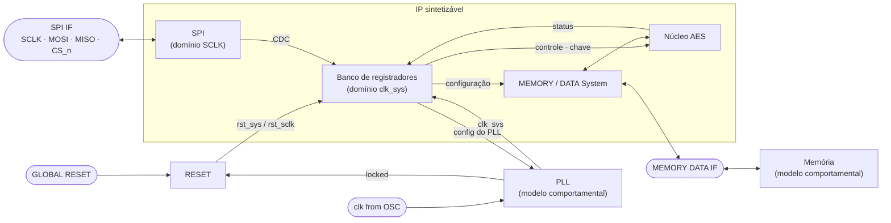

# Relatório de estudo — AES, SPI e o sistema de topo

**Semana 1 · Projeto AES Top-Level System · trilha RTL Design**

Este relatório resume o estudo do algoritmo AES (FIPS-197), do protocolo SPI e da arquitetura do sistema de topo, com foco no que cada assunto **exige do RTL**. Os valores numéricos citados foram conferidos com o modelo de referência do repositório ([`scripts/aes_ref.py`](../../scripts/aes_ref.py)). Esse modelo passa nos vetores do padrão e foi comparado com a biblioteca `cryptography` em 300 vetores aleatórios, sem divergências.

A especificação funcional e a Figura 1 ainda não foram recebidas. Por isso, a seção 4 descreve a arquitetura **como entendida a partir do texto do plano**, e as dúvidas que dependem da especificação estão reunidas na seção 7.

---

## 1. AES: visão geral

O AES (*Advanced Encryption Standard*, NIST FIPS-197, 2001, com revisão editorial em 2023) é uma **cifra de bloco simétrica**: a mesma chave cifra e decifra, e os dados são processados em blocos fixos de **128 bits**. O algoritmo é o Rijndael, de Daemen e Rijmen, restrito a esse tamanho de bloco.

| Variante | Chave | `Nk` (palavras de 32 bits) | `Nr` (rodadas) | Palavras de chave expandida `4·(Nr+1)` |
| --- | --- | --- | --- | --- |
| AES-128 | 128 bits | 4 | 10 | 44 |
| AES-192 | 192 bits | 6 | 12 | 52 |
| AES-256 | 256 bits | 8 | 14 | 60 |

O bloco tem sempre `Nb = 4` palavras (16 bytes). Só a chave e o número de rodadas mudam entre as variantes.

### 1.1 O estado e a ordem dos bytes

Internamente, o bloco é uma matriz 4 × 4 de bytes, o **estado**. Os 16 bytes de entrada `in[0..15]` preenchem a matriz **por colunas**: `s[r][c] = in[r + 4c]`.

```
              c=0     c=1     c=2     c=3
     r=0    in[0]   in[4]   in[8]   in[12]
     r=1    in[1]   in[5]   in[9]   in[13]
     r=2    in[2]   in[6]   in[10]  in[14]
     r=3    in[3]   in[7]   in[11]  in[15]
```

**Consequência para o RTL.** O padrão escreve os vetores como uma sequência hexadecimal (`3243f6a8…`), em que o primeiro par é `in[0]`. A convenção natural para um vetor `logic [127:0]` é, então, `in[0] = bloco[127:120]`, ou seja, o byte `i` em `bloco[127-8i -: 8]`. Cada coluna do estado é uma palavra de 32 bits contígua: `coluna c = bloco[127-32c -: 32]`. Fixar essa convenção cedo evita o erro mais comum em implementações de AES, que é a inversão da ordem de bytes ou de palavras entre o testbench, o núcleo e a interface de memória. A convenção final deve ser registrada no documento de arquitetura e conferida com a da trilha de verificação.

### 1.2 Estrutura da cifra

```
estado = entrada
AddRoundKey(estado, k[0])                       // chave inicial
para rodada = 1 até Nr-1:
    SubBytes(estado)
    ShiftRows(estado)
    MixColumns(estado)
    AddRoundKey(estado, k[rodada])
SubBytes(estado); ShiftRows(estado)             // última rodada:
AddRoundKey(estado, k[Nr])                      // sem MixColumns
saída = estado
```

A última rodada não tem MixColumns. Isso é deliberado: torna a decifra estruturalmente simétrica à cifra. Em hardware iterativo, significa um **multiplexador** que desvia o MixColumns na rodada `Nr`.

### 1.3 SubBytes

Substitui cada byte do estado, de forma independente, pela **S-box**. É a única transformação não linear do AES, e é dela que vem a resistência à criptoanálise linear e diferencial. A S-box é definida matematicamente em duas etapas:

1. **Inverso multiplicativo em GF(2⁸)**, com o polinômio irredutível `m(x) = x⁸ + x⁴ + x³ + x + 1` (`0x11B`). Por convenção, o 0 é levado em 0.
2. **Transformação afim** sobre GF(2): `s = b ⊕ rotl(b,1) ⊕ rotl(b,2) ⊕ rotl(b,3) ⊕ rotl(b,4) ⊕ 0x63`.

Valores de referência do padrão: `S(0x00) = 0x63`, `S(0x53) = 0xED`, `S(0xFF) = 0x16`.

**Implementação em hardware.** Há duas famílias:

| Abordagem | Como | Área | Atraso | Observação |
| --- | --- | --- | --- | --- |
| Tabela (LUT) | `case` de 256 entradas; a síntese gera lógica combinacional de 8 → 8 bits | maior | menor | A mais simples e a mais legível; a ferramenta otimiza bem |
| Campo composto | Inverso calculado em GF((2⁴)²) ou GF(((2²)²)²) por isomorfismo (Satoh et al., 2001; Canright, 2005) | bem menor | maior | Indicada quando a área é crítica; mais difícil de depurar |

O exemplo mínimo da semana 1 ([`rtl/aes_sbox.sv`](../../rtl/aes_sbox.sv)) usa a tabela. O testbench confere as 256 entradas contra a **definição matemática** acima, calculada no próprio testbench, e não contra outra cópia da tabela.

Numa microarquitetura iterativa de uma rodada por ciclo, são **16 S-boxes** no datapath. Com a expansão de chave calculada a cada rodada, são mais **4** no SubWord. Por isso a S-box é o maior bloco de área e está no caminho crítico.

### 1.4 ShiftRows

A linha `r` gira `r` posições para a esquerda: `s'[r][c] = s[r][(c + r) mod 4]`. A linha 0 não se move.

```
 antes                 depois
 s00 s01 s02 s03       s00 s01 s02 s03
 s10 s11 s12 s13  →    s11 s12 s13 s10
 s20 s21 s22 s23       s22 s23 s20 s21
 s30 s31 s32 s33       s33 s30 s31 s32
```

Em hardware é **apenas fiação**: não gera nenhuma porta. Em índices do vetor de entrada, `out[r + 4c] = in[r + 4·((c + r) mod 4)]`.

### 1.5 MixColumns

Cada coluna é multiplicada, em GF(2⁸), por uma matriz fixa:

```
 | b0 |   | 02 03 01 01 |   | a0 |
 | b1 | = | 01 02 03 01 | · | a1 |
 | b2 |   | 01 01 02 03 |   | a2 |
 | b3 |   | 03 01 01 02 |   | a3 |
```

A soma em GF(2⁸) é XOR. As multiplicações só envolvem as constantes 01, 02 e 03:

- `02·a = xtime(a)`: desloca 1 bit para a esquerda e, se o bit 7 era 1, faz XOR com `0x1B`. Em hardware é fiação mais 3 portas XOR.
- `03·a = xtime(a) ⊕ a`.

O MixColumns inteiro é, portanto, uma rede de **XORs**, sem multiplicadores. Exemplo do padrão (rodada 1 do Apêndice B): a coluna `d4 bf 5d 30` vira `04 66 81 e5`. Para `b0 = 02·d4 ⊕ 03·bf ⊕ 5d ⊕ 30 = b3 ⊕ da ⊕ 5d ⊕ 30 = 04`.

### 1.6 AddRoundKey

É o XOR bit a bit do estado com a chave da rodada (128 bits): uma camada de 128 XORs.

### 1.7 Expansão de chave

Gera `4·(Nr+1)` palavras `w[i]` de 32 bits a partir da chave. As primeiras `Nk` palavras são a própria chave. Para `i ≥ Nk`:

```
temp = w[i-1]
se i mod Nk == 0:      temp = SubWord(RotWord(temp)) ⊕ Rcon[i/Nk]
senão se Nk > 6 e i mod Nk == 4:  temp = SubWord(temp)      // só no AES-256
w[i] = w[i-Nk] ⊕ temp
```

- `RotWord([a0,a1,a2,a3]) = [a1,a2,a3,a0]` (fiação).
- `SubWord` aplica a S-box aos 4 bytes.
- `Rcon[j] = [x^(j-1), 00, 00, 00]`: `01 02 04 08 10 20 40 80 1b 36` para j = 1..10.

A chave da rodada `r` é `w[4r .. 4r+3]`. Exemplo do padrão (Apêndice A.1, chave `2b7e1516…`): `w[4] = a0fafe17` e a última chave de rodada é `d014f9a8 c9ee2589 e13f0cc8 b6630ca6`.

Há duas estratégias em hardware:

| Estratégia | Como | Custo |
| --- | --- | --- |
| **Sob demanda (*on-the-fly*)** | Calcula `k[r+1]` a partir de `k[r]` no mesmo ciclo da rodada | 4 S-boxes extras e um registrador de 128 bits; **nenhuma memória** de chaves |
| **Pré-calculada** | Calcula as 11 chaves uma vez e guarda | 1408 bits de armazenamento; latência de *setup* quando a chave muda |

Para AES-128 com cifra apenas, a expansão sob demanda é o caminho habitual. Na rodada, as 4 palavras da nova chave dependem umas das outras em cadeia (`w[i] = w[i-4] ⊕ w[i-1]`), o que soma 4 XORs ao caminho da chave. Esse caminho corre em paralelo com o datapath do estado.

### 1.8 Decifra

A decifra aplica as transformações inversas em ordem reversa: InvShiftRows (giro à direita), InvSubBytes (S-box inversa), AddRoundKey e InvMixColumns, com a matriz `0e 0b 0d 09`. As chaves de rodada são usadas **da última para a primeira**. Isso tem duas consequências para o hardware:

- InvMixColumns tem coeficientes maiores (`09, 0b, 0d, 0e`), o que dá uma rede de XOR mais profunda que a do MixColumns.
- Com expansão sob demanda, é preciso obter primeiro a **última** chave de rodada, o que exige uma passada da expansão antes de começar, e então inverter a recorrência a cada rodada.

**Se a especificação exige decifra ainda é uma questão em aberto (seção 7).** Isso pesa bastante na área e na escolha da microarquitetura.

### 1.9 Vetores de referência

Vetores de cifra do FIPS-197, todos conferidos pelo `make ref`:

| Origem | Chave | Texto claro | Texto cifrado |
| --- | --- | --- | --- |
| Ap. B (AES-128) | `2b7e151628aed2a6abf7158809cf4f3c` | `3243f6a8885a308d313198a2e0370734` | `3925841d02dc09fbdc118597196a0b32` |
| Ap. C.1 (AES-128) | `000102030405060708090a0b0c0d0e0f` | `00112233445566778899aabbccddeeff` | `69c4e0d86a7b0430d8cdb78070b4c55a` |
| Ap. C.2 (AES-192) | `000102…1617` | `00112233445566778899aabbccddeeff` | `dda97ca4864cdfe06eaf70a0ec0d7191` |
| Ap. C.3 (AES-256) | `000102…1e1f` | `00112233445566778899aabbccddeeff` | `8ea2b7ca516745bfeafc49904b496089` |

Valores **intermediários** do Apêndice B (início de cada rodada), que serão o oráculo dos testes unitários da semana 3. A tabela completa, com o estado depois de cada transformação, sai de `python3 scripts/aes_ref.py --trace`.

| Rodada | Estado no início da rodada | Chave da rodada |
| --- | --- | --- |
| 0 (entrada) | `3243f6a8885a308d313198a2e0370734` | `2b7e151628aed2a6abf7158809cf4f3c` |
| 1 | `193de3bea0f4e22b9ac68d2ae9f84808` | `a0fafe1788542cb123a339392a6c7605` |
| 2 | `a49c7ff2689f352b6b5bea43026a5049` | `f2c295f27a96b9435935807a7359f67f` |
| 3 | `aa8f5f0361dde3ef82d24ad26832469a` | `3d80477d4716fe3e1e237e446d7a883b` |
| 4 | `486c4eee671d9d0d4de3b138d65f58e7` | `ef44a541a8525b7fb671253bdb0bad00` |
| 5 | `e0927fe8c86363c0d9b1355085b8be01` | `d4d1c6f87c839d87caf2b8bc11f915bc` |
| 6 | `f1006f55c1924cef7cc88b325db5d50c` | `6d88a37a110b3efddbf98641ca0093fd` |
| 7 | `260e2e173d41b77de86472a9fdd28b25` | `4e54f70e5f5fc9f384a64fb24ea6dc4f` |
| 8 | `5a4142b11949dc1fa3e019657a8c040c` | `ead27321b58dbad2312bf5607f8d292f` |
| 9 | `ea835cf00445332d655d98ad8596b0c5` | `ac7766f319fadc2128d12941575c006e` |
| 10 | `eb40f21e592e38848ba113e71bc342d2` | `d014f9a8c9ee2589e13f0cc8b6630ca6` |
| saída | `3925841d02dc09fbdc118597196a0b32` | — |

### 1.10 Microarquiteturas possíveis

A escolha formal é da semana 2. O estudo levantou estas alternativas:

| Microarquitetura | Ciclos por bloco (AES-128) | Área relativa | Comentário |
| --- | --- | --- | --- |
| **Iterativa, 1 rodada/ciclo, datapath de 128 bits** | ~10–12 | 1× | Um conjunto de hardware de rodada reutilizado 10 vezes; registrador de estado de 128 bits; MUX para a última rodada. É o equilíbrio clássico e a sugestão do plano. |
| Desenrolada (10 rodadas combinacionais) | 1 (ciclo muito longo) | ~10× | Caminho crítico enorme; sem sentido fora de casos especiais |
| Desenrolada com *pipeline* | 1 bloco/ciclo de vazão, latência ~10 | ~10× + registradores | Vazão máxima; só faz sentido em modos sem realimentação (ECB, CTR) |
| Iterativa de 32 bits (1 coluna/ciclo) | ~40–50 | ~0,3–0,4× | 4 S-boxes compartilhadas; controle mais complexo |
| Iterativa de 8 bits | ~160+ | ≪ | Mínima área; latência alta |

Na opção iterativa de 128 bits, o caminho crítico esperado é `registrador → MUX de entrada → S-box → (ShiftRows: fiação) → MixColumns (~3 níveis de XOR) → MUX da última rodada → XOR da chave → registrador`. A S-box domina esse atraso.

**Ganchos para baixo consumo (fases 5 e 6).** Entre blocos, o núcleo fica ocioso e os registradores de estado e de chave não precisam ser atualizados. São candidatos naturais a **clock gating**. O isolamento de operandos na entrada das S-boxes evita chaveamento inútil quando o núcleo está parado. A chave e a configuração são candidatas a **retenção** quando o domínio do AES for desligado.

---

## 2. SPI

O SPI (*Serial Peripheral Interface*, originalmente da Motorola) é um barramento **serial, síncrono e full-duplex** com um mestre e um ou mais escravos. Não há um padrão formal único: o modo, o tamanho do quadro e o significado dos bits são definidos por cada dispositivo. É por isso que a especificação do sistema de topo precisa fixá-los.

### 2.1 Sinais

| Sinal | Direção (no escravo) | Função |
| --- | --- | --- |
| `SCLK` | entrada | Clock gerado pelo mestre; **só oscila durante a transferência** |
| `MOSI` | entrada | Dados do mestre para o escravo |
| `MISO` | saída | Dados do escravo para o mestre (alta impedância quando o escravo não está selecionado, se o barramento for compartilhado) |
| `CS_n` / `SS_n` | entrada | Seleção do escravo, ativa em nível baixo; delimita o quadro |

A cada pulso de `SCLK`, o mestre envia 1 bit pelo `MOSI` e recebe 1 bit pelo `MISO`. Os dois registradores de deslocamento formam um anel: ao fim de *n* pulsos, mestre e escravo trocaram *n* bits. A ordem mais comum é MSB primeiro.

### 2.2 Modos (CPOL e CPHA)

- **CPOL**: nível do `SCLK` em repouso (0 = baixo, 1 = alto).
- **CPHA**: em qual borda o dado é amostrado (0 = primeira borda do quadro, 1 = segunda borda).

| Modo | CPOL | CPHA | SCLK em repouso | Amostra na borda | Troca o dado na borda |
| --- | --- | --- | --- | --- | --- |
| 0 | 0 | 0 | baixo | subida | descida |
| 1 | 0 | 1 | baixo | descida | subida |
| 2 | 1 | 0 | alto | descida | subida |
| 3 | 1 | 1 | alto | subida | descida |

Modo 0, o mais comum, com um quadro de 8 bits:

```
CS_n  ‾‾\_______________________________________________/‾‾‾
SCLK  ______/‾\_/‾\_/‾\_/‾\_/‾\_/‾\_/‾\_/‾\______________
MOSI  ----< b7 >< b6 >< b5 >< b4 >< b3 >< b2 >< b1 >< b0 >----
MISO  ----< b7 >< b6 >< b5 >< b4 >< b3 >< b2 >< b1 >< b0 >----
             ^ amostra na subida;  o dado muda na descida
```

Em CPHA = 0, o **primeiro bit precisa estar no fio antes da primeira borda**, ou seja, já na descida do `CS_n`. Para o escravo, isso significa que o MSB do `MISO` vem de um registrador carregado antes do quadro, e não de um deslocamento.

### 2.3 Quadro típico de acesso a registradores

Em escravos de configuração, o quadro costuma ser `[R/W | endereço | dado]`. Exemplo genérico, **a confirmar com a especificação**:

```
 bit:  | 1  | A-1 ... 0 |  D-1 ... 0  |
 MOSI: |R/W | endereço  | dado (escrita) ou "não importa" (leitura) |
 MISO: |      não importa            | dado (leitura)              |
```

Na escrita, o dado chega por completo na **última borda** do quadro. Na leitura, o escravo precisa colocar o primeiro bit do dado no `MISO` logo depois de receber o último bit do endereço. Esse ponto é o mais delicado do projeto (§ 2.4).

### 2.4 O que isso exige do RTL do escravo

O plano define que o SPI opera **nativamente no SCLK**: o registrador de deslocamento, o contador de bits e o `MISO` ficam no domínio do SCLK; o banco de registradores e a interface com o AES ficam no domínio do sistema. As consequências:

1. **O SCLK para quando o quadro acaba.** Depois da última borda, não há mais bordas para "limpar" um pulso. Logo, o evento "quadro concluído" não pode ser um pulso de um ciclo de SCLK. Deve ser um **nível** ou um **toggle** (um bit que inverte a cada quadro) mantido até o próximo quadro. No domínio do sistema, esse bit passa por um sincronizador de 2 flip-flops e um detector de borda, que gera o pulso de um ciclo de `clk_sys`.

2. **Barramentos multibit não podem ser sincronizados bit a bit.** O endereço e o dado capturados no domínio do SCLK ficam **estáveis** até o próximo quadro. O domínio do sistema só os amostra depois de receber o evento sincronizado do item 1 (esquema de *data hold* / formulação MCP, Cummings 2008). Isso impõe um tempo mínimo entre quadros consecutivos, de alguns ciclos de `clk_sys`, que precisa constar da especificação ou ser garantido por `f_sys ≫ f_sclk`.

3. **Leitura: o dado precisa chegar a tempo.** No modo 0, entre a amostra do último bit de endereço (subida) e a saída do primeiro bit de dado (descida seguinte) há **meio período de SCLK**. Uma ida e volta pelo domínio do sistema (sincronizar o pedido, ler e trazer de volta) não cabe nesse intervalo. As saídas usuais são:
   - **(a)** bits ou bytes de espera (*dummy*) entre o endereço e o dado;
   - **(b)** leitura em *pipeline*, em que o dado lido sai no quadro **seguinte**;
   - **(c)** o domínio do SCLK lê diretamente os registradores do sistema por um MUX, porque eles são quase estáticos e só mudam por escrita SPI. Isso exige justificativa formal na análise de CDC, e os bits de **status**, que mudam sozinhos, precisam de captura sincronizada ou *snapshot*.

   A escolha **depende do protocolo do RTL de referência**, porque o VIP de SPI da trilha DV espera uma temporização específica. É a primeira pergunta a levar à especificação e ao parceiro (seção 7).

4. **Reset do domínio do SCLK.** O padrão é usar o `CS_n` inativo como reset assíncrono do contador de bits e da máquina do quadro (cada quadro começa limpo), combinado com o reset global. Na STA, isso gera verificações de *recovery/removal* em relação ao SCLK, garantidas pelo tempo entre a descida do `CS_n` e a primeira borda (`t_lead` do mestre).

5. **SCLK é um clock de verdade no chip.** Ele precisa de `create_clock` no SDC, de árvore de clock própria e de ser declarado **assíncrono** em relação ao `clk_sys` (`set_clock_groups -asynchronous`), como já prevê a semana 7.

6. **MISO em alta impedância** com `CS_n` inativo, se o barramento for compartilhado. No topo, isso pode virar um *pad* tri-state ou um par `miso`/`miso_oe`. É preciso confirmar o que o RTL de referência expõe.

---

## 3. Conceitos de CDC e de reset necessários

| Conceito | Para que serve no projeto |
| --- | --- |
| **Metaestabilidade** | Um flip-flop que amostra um sinal mudando dentro da janela de setup/hold pode demorar a resolver. Todo sinal que cruza de domínio passa por um sincronizador. |
| **Sincronizador de 2 FFs** | Sinais de 1 bit e de nível: o evento do quadro SPI (toggle), o `locked` do PLL (se cruzar domínios) |
| **Sincronizador de pulso por toggle** | Transformar "quadro concluído" (domínio SCLK) em um pulso de 1 ciclo em `clk_sys` |
| **Dados estáveis + controle sincronizado (MCP)** | Endereço e dado do SPI (multibit) |
| **Handshake req/ack** | Se uma leitura precisar de ida e volta controlada entre os domínios (opção (a) ou (b) de §2.4) |
| **Sincronizador de reset (assert assíncrono, deassert síncrono)** | Um por domínio: o reset entra assíncrono (funciona sem clock) e sai alinhado ao clock do domínio, sem violar *recovery/removal* |

As referências são Cummings, *Clock Domain Crossing (CDC) Design & Verification Techniques Using SystemVerilog* (SNUG 2008), e Cummings & Mills, *Synchronous Resets? Asynchronous Resets? I am so confused!* (SNUG 2002).

---

## 4. O sistema de topo, como entendido a partir do plano

> Diagrama **reconstruído a partir do texto**. Deve ser conferido com a Figura 1 e com a especificação assim que forem recebidas.



| Bloco | Domínio | Papel |
| --- | --- | --- |
| **RESET** | `clk_osc` / cada domínio | Recebe o GLOBAL RESET e gera um reset sincronizado por domínio. Segura o domínio do sistema em reset até o `locked`. |
| **PLL** (mock, `models/`) | gera `clk_sys` | Sai do reset com a configuração padrão e trava sozinho. Os registradores de configuração ficam no banco, no domínio do sistema, e só são reprogramados via SPI **depois** do `locked`. |
| **SPI** | SCLK | Recebe e envia os quadros; atravessa para o sistema conforme §2.4 |
| **Banco de registradores** | `clk_sys` | Configuração, controle e status do AES, do subsistema de dados e do PLL |
| **Núcleo AES** | `clk_sys` | Cifra (e talvez decifra) blocos de 128 bits |
| **MEMORY / DATA System** | `clk_sys` | Lê os blocos de entrada pela MEMORY DATA IF, entrega ao AES e escreve o resultado de volta |
| **Memória** (mock, `models/`) | `clk_sys` | Fora do IP sintetizável; atende à MEMORY DATA IF |

**Ponto de atenção: reconfiguração do PLL.** O banco de registradores roda no `clk_sys`, que vem do próprio PLL. Ao reprogramar o PLL, o `clk_sys` perde a estabilidade até o novo `locked`. Se o reset do sistema voltar a depender do `locked` nesse momento, o banco seria resetado e perderia a própria configuração que acabou de receber. A arquitetura da semana 2 precisa definir como isso se resolve. As alternativas são: separar o reset de *power-on* do reset por perda de `locked`; trocar o `clk_sys` para o `clk_osc` durante o novo travamento, com um MUX de clock sem *glitch*; ou o modelo garantir uma transição limpa. Também precisa ser alinhado com o modelo de PLL da trilha DV.

---

## 5. Conclusões para a semana 2

1. A **ordem dos bytes** (§1.1) deve ser fixada no documento de arquitetura e conferida com a trilha DV antes de qualquer RTL de rodada.
2. A microarquitetura **iterativa de 128 bits com expansão de chave sob demanda** é a candidata natural para AES-128 com cifra apenas. Se a especificação exigir decifra ou outros tamanhos de chave, a decisão precisa ser revista (§1.8).
3. A forma de fazer **leitura via SPI** (§2.4, item 3) é a decisão de CDC mais importante do projeto. Ela depende da temporização do RTL de referência.
4. A **reconfiguração do PLL** (§4) precisa de uma estratégia explícita de clock e reset.
5. O núcleo AES será desenvolvido (semanas 3 e 4) **antes** do SPI, contra uma interface definida na semana 2. Por isso essa interface precisa ser simples e estável.

---

## 6. O que foi construído para apoiar o estudo

- **[`scripts/aes_ref.py`](../../scripts/aes_ref.py)**: AES-128/192/256 em Python puro, cifra e decifra, com `--trace` (estado depois de cada transformação, no formato do Apêndice B), `--keyexp` (palavras `w[i]`) e `--sbox`. A S-box é **calculada** pela definição (inverso em GF(2⁸) + afim), não copiada.
- **[`rtl/aes_sbox.sv`](../../rtl/aes_sbox.sv)** e **[`tb/tb_aes_sbox.sv`](../../tb/tb_aes_sbox.sv)**: exemplo mínimo do fluxo. O testbench reimplementa a aritmética de GF(2⁸) em SystemVerilog para conferir as 256 entradas.

---

## 7. Questões em aberto para a especificação e para o verificador parceiro

**AES**

1. Só cifra, ou cifra e decifra?
2. Só AES-128, ou também 192 e 256?
3. Algum modo de operação além de bloco a bloco (ECB)? Por exemplo, CBC ou CTR.
4. Como a chave chega: registradores via SPI (quantos, em que ordem de bytes)?
5. Qual a convenção de ordem de bytes dos blocos na memória e nos registradores?

**SPI**

6. Qual o modo (CPOL/CPHA)? É MSB primeiro?
7. Qual o formato do quadro (bit R/W, largura do endereço, largura do dado), e há bytes de espera na leitura?
8. Qual a relação máxima `f_sclk / f_sys`, e qual o tempo mínimo entre quadros?
9. O `MISO` fica em alta impedância com `CS_n` inativo? Como aparece no topo?

**MEMORY DATA IF**

10. Qual o protocolo (estilo SRAM síncrona `addr/we/wdata/rdata`, ou `valid/ready`)? Qual a largura dos dados e dos endereços? Qual a latência de leitura?
11. O IP é mestre da interface? Endereços de origem e destino e número de blocos são configurados via SPI?

**Clock, reset e PLL**

12. Quais são os bits de configuração do PLL e o valor padrão?
13. O que acontece com o `clk_sys` e com o reset durante uma reconfiguração (§4)?
14. O GLOBAL RESET é ativo em nível baixo? Síncrono ou assíncrono em relação ao `clk_osc`?
15. Como o mestre SPI sabe que o sistema saiu do reset: lê um bit de status de `locked`?

**Interação com a trilha DV**

16. Quais são os nomes exatos dos sinais de topo e dos módulos e portas dos modelos do PLL e da memória no RTL de referência? (Necessário para o reaproveitamento do ambiente na segunda etapa.)

---

## Referências

- NIST. *FIPS PUB 197: Advanced Encryption Standard (AES)*, 2001; revisão editorial FIPS 197-upd1, 2023.
- J. Daemen, V. Rijmen. *The Design of Rijndael*. Springer, 2002.
- A. Satoh et al. *A Compact Rijndael Hardware Architecture with S-Box Optimization*. ASIACRYPT 2001.
- D. Canright. *A Very Compact S-Box for AES*. CHES 2005.
- Motorola/Freescale. *SPI Block Guide* (S12SPIV3).
- C. E. Cummings. *Clock Domain Crossing (CDC) Design & Verification Techniques Using SystemVerilog*. SNUG Boston, 2008.
- C. E. Cummings, D. Mills. *Synchronous Resets? Asynchronous Resets? I am so confused! How will I ever know which to use?* SNUG San Jose, 2002.
