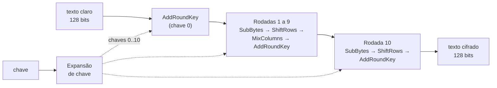
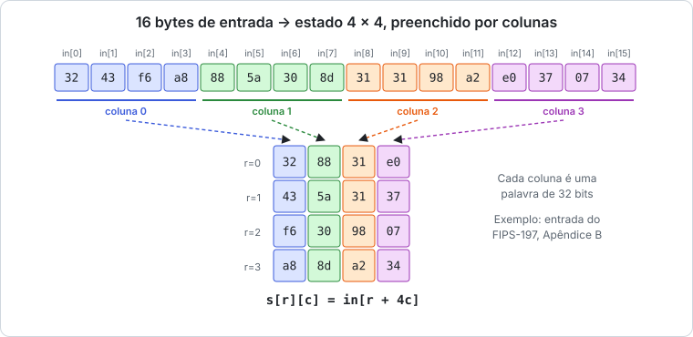
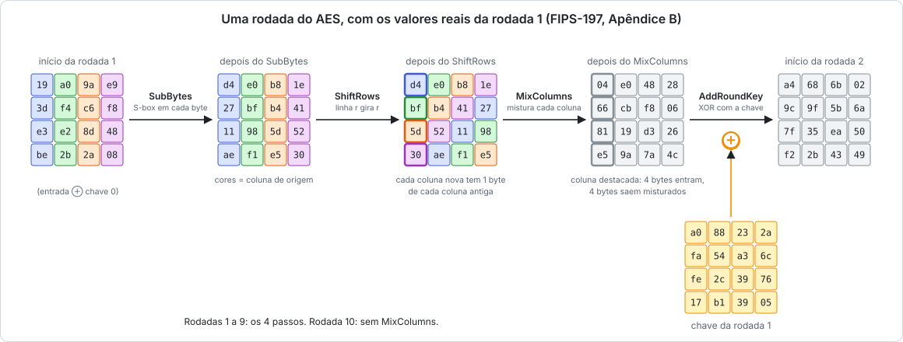
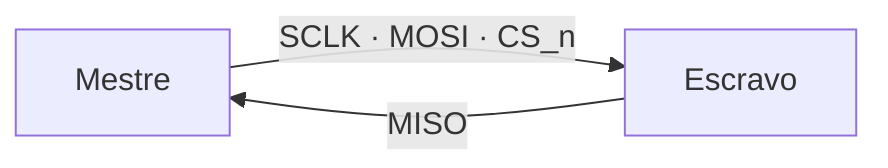
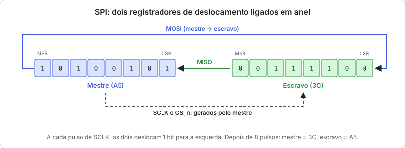
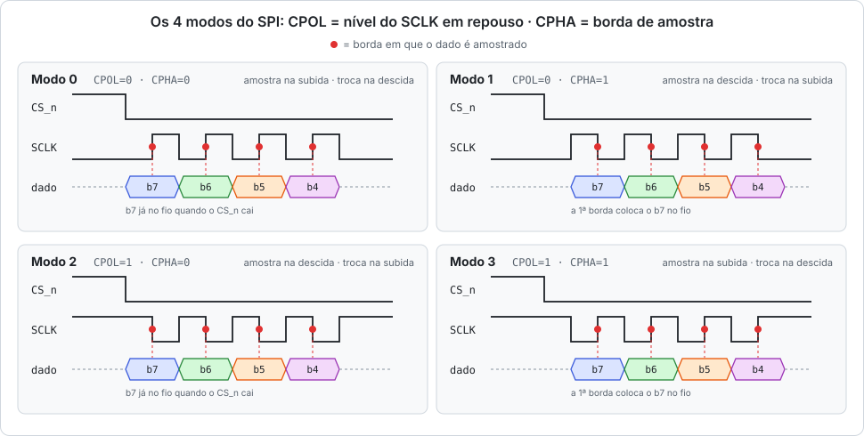

# Semana 01: AES e SPI em resumo

Resumo do estudo pedido na semana 1 do [enunciado](enunciado.md): o algoritmo **AES** (NIST FIPS-197) e o protocolo **SPI** (modos de operação, polaridade e fase de clock).

**Sumário:** [1. AES](#1-aes) · [2. SPI](#2-spi) · [Referências](#referências)

---

## 1. AES

### 1.1 O que é

O AES é uma **cifra de bloco simétrica**: a mesma chave cifra e decifra, e os dados são processados em blocos fixos de **128 bits (16 bytes)**.

| Variante | Chave | Rodadas | Chaves de rodada |
| --- | --- | --- | --- |
| **AES-128** | 128 bits | 10 | 11 |
| AES-192 | 192 bits | 12 | 13 |
| AES-256 | 256 bits | 14 | 15 |



### 1.2 O estado

Internamente, o bloco é uma matriz **4 × 4 de bytes**, o *estado*, preenchida **por colunas**:



> **Ordem dos bytes:** o padrão escreve os blocos em hexadecimal com `in[0]` primeiro (em `3243f6a8…`, `in[0] = 32`). Cada coluna do estado corresponde a 4 bytes consecutivos da entrada. Trocar a ordem dos bytes é um erro clássico em implementações de AES.

### 1.3 Uma rodada

Cada rodada aplica quatro transformações. A figura usa os **valores reais** da rodada 1 do Apêndice B do FIPS-197:



| Transformação | O que faz | Por que existe | Em hardware |
| --- | --- | --- | --- |
| **SubBytes** | Troca cada byte pela **S-box** (inverso em GF(2⁸) + transformação afim) | É a **única parte não linear** (confusão) | Tabela 8 → 8 bits; costuma ser o maior bloco e estar no caminho crítico |
| **ShiftRows** | A linha `r` gira `r` posições à esquerda | Espalha os bytes entre colunas | **Só fiação**: zero portas |
| **MixColumns** | Multiplica cada coluna por uma matriz fixa em GF(2⁸) | Mistura os 4 bytes da coluna (difusão) | **Só XOR**: multiplicar por 2 é deslocar e, se estourar, XOR com `0x1B` |
| **AddRoundKey** | XOR do estado com a chave da rodada | É o único passo que usa a chave | 128 portas XOR |

A última rodada **não tem MixColumns**.

Juntas, as transformações espalham qualquer diferença muito rápido. Mudando **1 bit** da entrada, o número de bytes diferentes no estado é:

| Início da rodada | 1 | 2 | 3 em diante |
| --- | --- | --- | --- |
| Bytes diferentes (de 16) | 1 | 4 | **16** |

### 1.4 Expansão de chave

As 11 chaves de rodada (AES-128) saem da chave original, palavra por palavra (`w[0]`…`w[43]`, 32 bits cada):

```
w[0..3] = chave
w[i]    = w[i-4] ⊕ w[i-1]                                      (i não múltiplo de 4)
w[i]    = w[i-4] ⊕ SubWord(RotWord(w[i-1])) ⊕ Rcon[i/4]        (i múltiplo de 4)
```

**Exemplo (FIPS-197):** com a chave `2b7e1516 28aed2a6 abf71588 09cf4f3c`, sai `w[4] = a0fafe17`.

Em hardware, há duas abordagens comuns: calcular cada chave **sob demanda**, a cada rodada (4 S-boxes extras, sem memória), ou **pré-calcular** e armazenar as 11 chaves (1408 bits).

---

## 2. SPI

### 2.1 O que é

O SPI é um barramento **serial, síncrono e full-duplex** entre um **mestre** e um ou mais **escravos**. Segundo o enunciado, o sistema do projeto é configurado e controlado por uma interface SPI.

| Sinal | Quem gera | Função |
| --- | --- | --- |
| `SCLK` | mestre | Clock serial; **só oscila durante a transferência** |
| `MOSI` | mestre | Dado do mestre para o escravo |
| `MISO` | escravo | Dado do escravo para o mestre |
| `CS_n` | mestre | Seleciona o escravo (ativo em baixo) e **delimita o quadro** |



### 2.2 Como os bits trafegam

Mestre e escravo têm **registradores de deslocamento ligados em anel**. A cada pulso de `SCLK`, os dois deslocam 1 bit ao mesmo tempo. Depois de 8 pulsos, trocaram o conteúdo:



Consequência: **para ler, o mestre precisa escrever**. Ele envia bytes "vazios" (*dummy*) só para gerar os pulsos que trazem o dado do escravo.

### 2.3 Modos: CPOL e CPHA

- **CPOL**: nível do `SCLK` em repouso (0 = baixo, 1 = alto).
- **CPHA**: borda de amostra (0 = primeira borda, 1 = segunda borda).

Em todos os modos, o dado é **lançado numa borda e amostrado na borda oposta**. Assim ele tem meio período de clock para estabilizar.



| Modo | CPOL | CPHA | SCLK em repouso | Amostra na | Troca na |
| --- | --- | --- | --- | --- | --- |
| **0** | 0 | 0 | baixo | subida | descida |
| 1 | 0 | 1 | baixo | descida | subida |
| 2 | 1 | 0 | alto | descida | subida |
| 3 | 1 | 1 | alto | subida | descida |

> **Detalhe importante:** com **CPHA = 0**, a primeira borda já é de amostra. O primeiro bit precisa estar no `MISO` **assim que o `CS_n` cai**, antes de qualquer borda do `SCLK`.

### 2.4 Quadro de acesso a registradores

O SPI só define como os bits trafegam; o significado deles é definido por cada dispositivo. Um formato comum em dispositivos configurados por registradores:

| Campo | R/W | Endereço | Dado |
| --- | --- | --- | --- |
| `MOSI` | 1 bit | *A* bits | escrita: dado · leitura: *dummy* |
| `MISO` | - | - | leitura: dado do registrador |

---

## Referências

- NIST. *FIPS PUB 197: Advanced Encryption Standard (AES)*, 2001 (revisão editorial FIPS 197-upd1, 2023).
- J. Daemen, V. Rijmen. *The Design of Rijndael*. Springer, 2002.
- Motorola/Freescale. *SPI Block Guide*.
